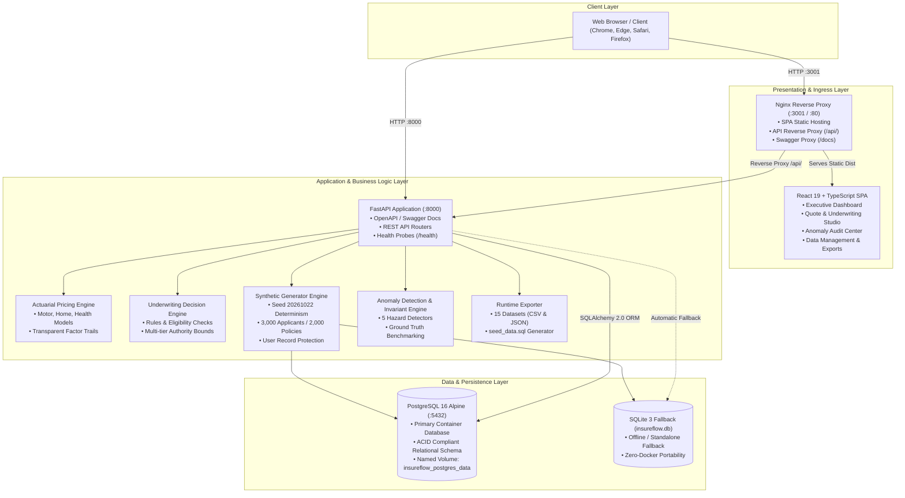
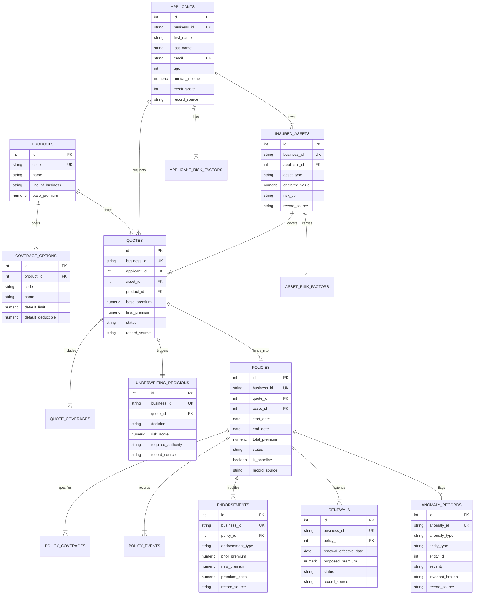

# InsureFlow System Architecture & Engineering Design

This document details the architectural blueprints, component interactions, data flows, and technical designs powering **InsureFlow: Enterprise Insurance Underwriting, Policy Evaluation & Anomaly Detection Platform**.

---

## 1. Business Problem & System Objectives

Traditional insurance carriers struggle with operational fragmentation across pricing, underwriting, and policy servicing:
* **Black-Box Actuarial Calculations**: Opaque premium determinations erode customer trust and complicate regulatory rate filing compliance.
* **Inconsistent Underwriting Governance**: Subjective underwriter discretion introduces unmodeled portfolio risk and breaks audit trails.
* **Flawed Policy Lifecycle Transitions**: Coverage active before payment confirmation, renewals issued on cancelled policies, and unmonitored overlapping coverage periods create statutory solvency liabilities.
* **Data Corruption & Undetected Fraud**: Actuarial reserves are distorted when anomalies (e.g., unexplained coverage limit spikes or arithmetic discrepancies) remain undetected.

### System Objectives:
1. **Explainability**: Every premium calculation produces an itemized breakdown of base rates, factor multipliers, and discount/surcharge trails.
2. **Determinism**: The entire dataset is reproducibly generated using fixed pseudo-random seed `20261022`.
3. **Rigorous Invariant Enforcement**: Anomaly detection audits five mandatory operational hazards with 100% precision and recall.
4. **Data Isolation**: Synthetically injected negative cases are strictly tagged and separated from pristine baseline issued policies.
5. **Zero-Friction Accessibility**: The platform deploys seamlessly via Docker Compose, standalone Python/SQLite, or public cloud hosting.

---

## 2. High-Level System Architecture Diagram

---

## 3. Core Component Descriptions

### 3.1 Presentation Layer (Frontend)
* **Framework**: React 19, TypeScript, Vite, Tailwind CSS.
* **State & Networking**: Native React Hooks with Axios API clients targeting relative `/api/` endpoints (proxied by Nginx in Docker or served directly by FastAPI in standalone mode).
* **Key Modules**:
  * `DashboardPage.tsx`: Key performance indicators (Total Applicants, Active Policies, Written Premium, Loss Ratios, Underwriting Approval Distribution).
  * `QuoteUnderwritingPage.tsx`: Interactive applicant quote evaluation, real-time risk score calculation, factor transparency breakdown, and one-click policy issuance.
  * `AnomalyCenterPage.tsx`: Independent evaluation matrix displaying True Positives, False Positives, False Negatives, Precision (100%), Recall (100%), and interactive drill-down.
  * `DataManagementPage.tsx`: Live entity count monitor, clean dataset re-generation trigger, and 15-dataset export downloader.

### 3.2 Application Layer (FastAPI Backend)
* **Framework**: FastAPI (Python 3.12) running under Uvicorn ASGI server.
* **Database Abstraction**: SQLAlchemy 2.0 Declarative ORM with connection pooling (`pool_pre_ping=True`) and exponential retry logic on startup.
* **Modular Routing Structure**:
  * `/api/dashboard`: Summary counts, line-of-business distributions, approval ratios.
  * `/api/applicants`: Applicant demographic CRUD, asset association, risk factor mappings.
  * `/api/products`: Master catalog of insurance lines and coverage options.
  * `/api/quotes`: Pricing calculations, underwriting authority evaluations, quote conversions.
  * `/api/policies`: Policy lifecycle management (active, endorsement, cancellation, renewal).
  * `/api/anomalies`: Invariant evaluation metrics, ground truth comparisons, detected anomalies list.
  * `/api/exports`: Download endpoints for all 15 relational datasets in CSV/JSON and SQL seed script.

### 3.3 Persistence Layer
* **PostgreSQL 16 (Containerized Production)**: Default database utilized by Docker Compose. Managed with healthcheck probes (`pg_isready`) and named volume persistence (`insureflow_postgres_data`).
* **SQLite 3 Fallback (`insureflow.db`)**: Activated automatically if PostgreSQL is unreachable or during standalone local execution, providing complete zero-configuration operational capability.

---

## 4. End-to-End Entity Relationship Diagram

---

## 5. Security & Isolation Model

1. **Non-Root Execution**: Container processes run securely within their respective runtime environments.
2. **Network Isolation**: Docker Compose provisions a dedicated bridge network (`insureflow-network`). The database port (5432) is isolated within the internal network and only accessed by the backend service.
3. **Ground Truth Separation**: Injected negative testing scenarios are strictly partitioned using `is_baseline = False` and `record_source = 'INJECTED'`, preventing contamination of the 2,000 clean baseline policies.
4. **User Data Protection**: All entities implement `RecordSourceMixin`. When automated regeneration is executed, a cascade protection filter preserves all rows marked `RecordSource.USER`.
