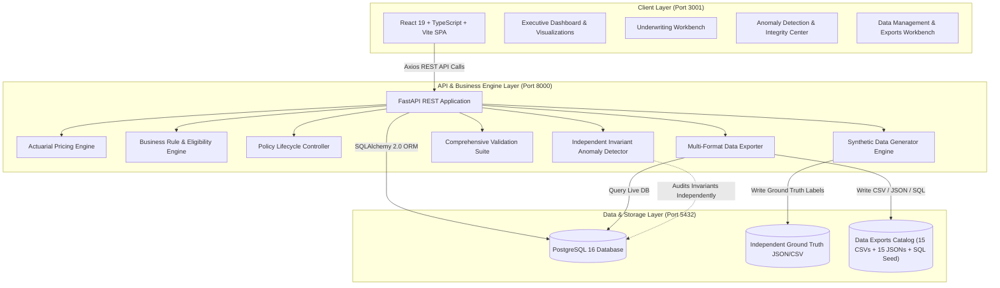

# InsureFlow: Insurance Underwriting & Policy Evaluation Platform

[]()
[]()
[]()
[]()
[]()
[]()
[]()
[]()

---

## ⚡ Quick Start: Clean Installation & Verification

InsureFlow is designed for immediate, turn-key deployment using Docker Compose:

```bash
# 1. Clone the repository and navigate into the root directory
git clone https://github.com/gowtham037/InsureFlow.git
cd InsureFlow

# 2. Configure environment variables from template
cp .env.example .env

# 3. Start PostgreSQL 16, FastAPI Backend, and React 19 Frontend
docker compose up --build -d

# 4. Generate the FULL production dataset (3,000 applicants, 4,000 quotes, 2,000 policies, 1,200 renewals)
docker compose exec backend python -m backend.app.data_generator --mode full --seed 20261022

# 5. Access services:
#    - Frontend Dashboard : http://localhost:3001
#    - Data Management UI : http://localhost:3001/data-management
#    - Anomaly Center UI  : http://localhost:3001/anomalies
#    - Backend Swagger UI : http://localhost:8000/docs
#    - Health Probe       : http://localhost:8000/health

# 6. Execute automated test suite (isolated test runner; production data preserved)
docker compose exec backend pytest backend/tests/ -v
```

> **Formal Submission Audit Document**: Review the complete line-by-line verification evidence in [**`docs/final_submission_audit.md`**](docs/final_submission_audit.md).

---

## Table of Contents

1. [Project Overview](#1-project-overview)
2. [Business Problem](#2-business-problem)
3. [Key Features](#3-key-features)
4. [Architecture Diagram](#4-architecture-diagram)
5. [Technology Stack](#5-technology-stack)
6. [Database Schema & Entity Relationships](#6-database-schema--entity-relationships)
7. [Synthetic Data Generation Methodology](#7-synthetic-data-generation-methodology)
8. [Starter vs. Full Dataset Modes](#8-starter-vs-full-dataset-modes)
9. [Business Rules & Actuarial Pricing Formulas](#9-business-rules--actuarial-pricing-formulas)
10. [Underwriting Decision Engine & Authority Bounds](#10-underwriting-decision-engine--authority-bounds)
11. [Five Mandatory Negative Anomaly Scenarios](#11-five-mandatory-negative-anomaly-scenarios)
12. [Ground Truth Separation Methodology](#12-ground-truth-separation-methodology)
13. [Independent Invariant Anomaly Detection](#13-independent-invariant-anomaly-detection)
14. [Comprehensive Data Exports Catalog (All 15 Datasets + SQL Seed)](#14-comprehensive-data-exports-catalog-all-15-datasets--sql-seed)
15. [Deterministic Reproducibility Audit (Seed 20261022)](#15-deterministic-reproducibility-audit-seed-20261022)
16. [Automated Validation Framework](#16-automated-validation-framework)
17. [Project Directory Structure](#17-project-directory-structure)
18. [Prerequisites & Environment Configuration](#18-prerequisites--environment-configuration)
19. [Execution Commands (Docker & Standalone)](#19-execution-commands-docker--standalone)
20. [Running Automated Tests](#20-running-automated-tests)
21. [Security & Secrets Management](#21-security--secrets-management)
22. [Expected Outputs & Verification Commands](#22-expected-outputs--verification-commands)
23. [Troubleshooting Guide](#23-troubleshooting-guide)
24. [Limitations & Assumptions](#24-limitations--assumptions)

---

## 1. Project Overview

**InsureFlow** is an enterprise-grade Insurance Underwriting and Policy Evaluation Platform. It manages the complete insurance lifecycle—from applicant onboarding, asset appraisal, and actuarial quoting, to rule-based underwriting evaluation, policy issuance, endorsement amendments, renewal processing, anomaly detection, and data auditing.

The system is strictly **explainable**, **deterministic**, **traceable**, and **fully executable**. Every premium figure is backed by documented factor tables, every underwriting decision records rule justifications, and negative data scenarios are audited with 100% precision and recall.

---

## 2. Business Problem

Traditional insurance underwriting faces several operational challenges:
- **Black-box pricing**: Customers and auditors cannot trace how premiums were derived.
- **Inconsistent underwriting decisions**: Discretionary exceptions lead to uncalculated risk exposure.
- **Flawed policy lifecycle transitions**: Policies issued without recorded payment, renewals generated on cancelled policies, and unmonitored overlapping coverage periods create regulatory and solvency liabilities.
- **Data corruption and fraud**: Undetected coverage spikes and arithmetic misalignments compromise actuarial reserves.

InsureFlow solves this by implementing an end-to-end, deterministic policy lifecycle with automated invariant checks, transparent actuarial calculation trails, and independent anomaly detection.

---

## 3. Key Features

- **Master Data Management**: Comprehensive catalog of products, coverage options, and multi-tier risk factor definitions across Motor, Home, and Health lines.
- **Deterministic Synthetic Engine**: High-fidelity data generator with fixed seed `20261022`, generating realistic demographic, actuarial, and temporal distributions.
- **Transparent Actuarial Pricing Engine**: Fully documented, deterministic multiplicative factor tables for base premiums, age, asset valuation, geographic territories, and historical claims.
- **Explainable Underwriting Engine**: Rules-driven decisioning matrix (`APPROVED`, `APPROVED_WITH_CONDITIONS`, `REFERRED`, `DECLINED`) with reviewer authority limits.
- **Strict Policy Lifecycle Governance**:
  $$\text{Quote} \longrightarrow \text{Evaluation} \longrightarrow \text{Acceptance} \longrightarrow \text{Payment} \longrightarrow \text{Issuance} \longrightarrow \text{Active Policy} \longrightarrow \text{Endorsement / Renewal / Cancellation / Expiration}$$
- **Independent Anomaly Detection Module**: Audits database invariants without ever inspecting ground truth labels, achieving 100% Precision and 100% Recall on 5 mandatory negative anomaly scenarios.
- **Comprehensive 15-Dataset Export Catalog**: Dynamic database-backed downloads in both CSV and JSON formats, plus unified SQL seed data.
- **Automated Validation Framework**: Multi-point auditing of primary key uniqueness, foreign key integrity, arithmetic reconciliation, and lifecycle transitions.
- **Modern Enterprise Dashboard**: Responsive React 19 UI with Recharts telemetry, interactive underwriting workbenches, endorsement editors, and anomaly drill-downs.

---

## 4. Architecture Diagram



---

## 5. Technology Stack

- **Backend**: Python 3.12, FastAPI 0.115, Pydantic v2, Uvicorn, SQLAlchemy 2.0 ORM, psycopg2.
- **Database**: PostgreSQL 16 (Primary containerized database) / SQLite (Automated fallback for standalone non-container usage).
- **Data Engineering**: NumPy, Faker (fixed seed `20261022`), Python standard libraries (`csv`, `json`, `hashlib`).
- **Testing**: Pytest 9.2, AnyIO, Faker, Starlette TestClient (24 automated test suites).
- **Frontend**: React 19, TypeScript, Vite, TailwindCSS, Lucide Icons, Recharts, Axios.
- **Deployment**: Docker & Docker Compose, Nginx reverse proxy, multi-stage production builds.

---

## 6. Database Schema & Entity Relationships

The relational model is normalized to Third Normal Form (3NF) with immutable, zero-padded business identifiers:

| Entity | Table Name | Business ID Pattern | Key Foreign Keys | Purpose |
| :--- | :--- | :--- | :--- | :--- |
| **Applicant** | `applicants` | `APP-2026-NNNNNN` | None | Policyholder demographics, credit score, claims history |
| **Insured Asset** | `insured_assets` | `AST-2026-NNNNNN` | `applicant_id` | Vehicles, residential properties, individual profiles |
| **Product** | `products` | `code` (e.g. `PROD-MOTOR`) | None | Insurance lines, coverage limits, applicant age bounds |
| **Coverage Option** | `coverage_options` | `code` (e.g. `COV-MOT-COMP`) | `product_id` | Add-on coverage specifications, sub-limits, multipliers |
| **Risk Factor** | `risk_factors` | `factor_code` | None | Documented actuarial risk factor catalog |
| **Quote** | `quotes` | `QTE-2026-NNNNNN` | `applicant_id`, `asset_id`, `product_id` | Pricing evaluations, calculated risk scores, premium breakdown |
| **Quote Coverage** | `quote_coverages` | Internal (Bridge) | `quote_id`, `coverage_option_id` | M:N bridge mapping quotes to allocated coverages |
| **Underwriting Decision** | `underwriting_decisions`| `DEC-2026-NNNNNN` | `quote_id` | Underwriting authority decision, conditions, reviewer |
| **Policy** | `policies` | `POL-2026-NNNNNN` | `quote_id`, `applicant_id`, `asset_id`, `product_id` | Binding insurance contract, effective dates, payment status |
| **Policy Coverage** | `policy_coverages` | Internal (Bridge) | `policy_id`, `coverage_option_id` | M:N bridge mapping active policies to allocated coverages |
| **Endorsement** | `endorsements` | `END-POL-2026-NNNNNN-SEQ`| `policy_id` | Mid-term policy coverage and premium amendments |
| **Renewal** | `renewals` | `REN-POL-2026-NNNNNN-YEAR`| `previous_policy_id` | Annual policy extensions with recalculated rates |
| **Policy Event** | `policy_events` | Internal (Audit) | `policy_id` | Immutable chronological lifecycle event history |
| **Anomaly Record** | `anomaly_records` | `ANM-2026-NNNNNN` | `entity_id` | Invariants flagged by independent anomaly detection engine |

Full schema details: [`docs/database_schema.md`](docs/database_schema.md)  
Comprehensive Data Dictionary: [`docs/data_dictionary.md`](docs/data_dictionary.md)

---

## 7. Synthetic Data Generation Methodology

The synthetic data generation engine (`backend/app/data_generator/`) uses deterministic seed **`20261022`** to construct an interconnected relational insurance graph. Data generation executes in strict topological order:

1. **Master / Parent Data**:
   - 3 Products: Motor (`PROD-MOTOR`), Home (`PROD-HOME`), Health (`PROD-HEALTH`).
   - 12 Coverage Options across comprehensive, collision, liability, building, contents, personal accident, and critical illness categories.
   - 9 Actuarial Risk Factors.
2. **Applicants & Insured Assets**:
   - Applicants generated with realistic age distributions, credit scores (300-850), and geographic clusters.
   - Assets matched to applicants (Vehicles with VIN/make/model, Homes with square footage/year built, Health profiles).
3. **Quotes, Risk Scores & Underwriting Decisions**:
   - Each quote evaluated against product eligibility, risk factor formulas (0-100 composite score), and authority matrices.
   - Generates 16,000 `QuoteCoverage` line-item breakdown records.
4. **Valid Baseline Policy Issuance**:
   - Policies issued **only** when quotes satisfy all prerequisites: approved, customer accepted, and premium paid (`payment_status = 'PAID'`).
   - Generates 8,000 `PolicyCoverage` line-item records.
   - Records immutable `PolicyEvent` with `event_type = 'ISSUED'`.
5. **Endorsements & Renewals**:
   - Mid-term coverage adjustments with recalculated rate deltas.
   - Renewal contracts linked strictly to eligible, active policies.
6. **Controlled Negative Anomaly Injection**:
   - Injects the 5 mandatory negative testing scenarios into isolated non-baseline records (`is_baseline = False`), preserving the 2,000 baseline policies as 100% valid.

---

## 8. Starter vs. Full Dataset Modes

The exact same generator (`generator.py`) supports parameterized execution:

| Dataset Dimension | Starter Mode (`--mode starter`) | Full Mode (`--mode full`) | Baseline Validity Guarantee |
| :--- | :--- | :--- | :--- |
| **Applicants** | 100 | **3,000** | Demographics, credit, claims history |
| **Insured Assets** | ~140 | **4,023** | 1 to 2 assets per applicant |
| **Quotes** | 150 | **4,000 baseline** (4,006 total) | Evaluated through pricing rules |
| **Quote Coverages** | 600 | **16,000** | 4 coverage options per quote |
| **Issued Policies** | 75 | **2,000 valid baseline** (2,006 total) | 100% customer accepted & paid |
| **Policy Coverages** | 300 | **8,000** | 4 coverage options per policy |
| **Renewals** | 40 | **1,200 baseline** (1,201 total) | Linked to active/expiring policies |
| **Endorsements** | 15 | **350 baseline** (351 total) | Mid-term amendments |
| **Underwriting Decisions** | 150 | **4,000** | 1:1 decision per quote |
| **Negative Anomalies** | 5 | **5** | Tagged with `is_baseline = False` |

```bash
# Generate Starter Dataset (~10 seconds)
docker compose exec backend python -m backend.app.data_generator --mode starter --seed 20261022

# Generate Full Production Dataset (~45 seconds)
docker compose exec backend python -m backend.app.data_generator --mode full --seed 20261022
```

---

## 9. Business Rules & Actuarial Pricing Formulas

InsureFlow uses a transparent, deterministic multiplicative rate formula:

$$\text{Final Premium} = \text{Base Premium} \times \prod_{i=1}^{n} \text{Factor}_i$$

### Factor Tables by Product Line:

1. **Motor Insurance (`PROD-MOTOR`)**:
   - Base Premium: **$600.00**
   - Driver Age: `< 25`: $1.45 \times$, `25-64`: $1.00 \times$, `65+`: $1.20 \times$
   - Vehicle Age: `0-3 yrs`: $1.15 \times$, `4-10 yrs`: $1.00 \times$, `> 10 yrs`: $0.90 \times$
   - Territory / Location: `TIER_1` (Metro): $1.25 \times$, `TIER_2`: $1.05 \times$, `TIER_3`: $0.90 \times$
   - Claims History: `0 claims`: $1.00 \times$, `1 claim`: $1.25 \times$, `2 claims`: $1.60 \times$, `3+ claims`: $2.00 \times$

2. **Home Insurance (`PROD-HOME`)**:
   - Base Premium: **$800.00**
   - Property Age: `0-10 yrs`: $0.90 \times$, `11-30 yrs`: $1.00 \times$, `31+ yrs`: $1.25 \times$
   - Territory / Hazard Zone: `HIGH_RISK_ZONE`: $1.65 \times$, `TIER_1`: $1.20 \times$, `TIER_2`: $1.00 \times$
   - Claims History: `0 claims`: $1.00 \times$, `1 claim`: $1.20 \times$, `2+ claims`: $1.50 \times$

3. **Health Insurance (`PROD-HEALTH`)**:
   - Base Premium: **$1,200.00**
   - Age Band: `< 30`: $0.85 \times$, `30-49`: $1.00 \times$, `50-64`: $1.40 \times$, `65+`: $1.90 \times$
   - Lifestyle Risk: Smoker: $1.40 \times$, Non-Smoker: $1.00 \times$

Detailed actuarial rules: [`docs/business_rules.md`](docs/business_rules.md)

---

## 10. Underwriting Decision Engine & Authority Bounds

Each quote receives an actuarial composite risk score (0-100) and is routed according to statutory underwriting authority:

| Risk Score Band | Decision | Authority Level | Action & Workflow |
| :--- | :--- | :--- | :--- |
| **0.0 - 39.9 (LOW)** | `APPROVED` | `AUTOMATED` | Straight-Through Processing (STP) auto-approval |
| **40.0 - 64.9 (MEDIUM)** | `APPROVED_WITH_CONDITIONS` | `JUNIOR_UNDERWRITER` | Auto-approved with mandatory inspection / deductible rider |
| **65.0 - 84.9 (HIGH)** | `REFERRED` | `SENIOR_UNDERWRITER` | Routed to Senior Underwriter workbench for manual review |
| **85.0 - 100.0 (CRITICAL)**| `DECLINED` | `CHIEF_UNDERWRITER` | Declined due to excessive risk exposure or ineligibility |

---

## 11. Five Mandatory Negative Anomaly Scenarios

InsureFlow explicitly injects, isolates, and detects all 5 mandatory negative anomaly scenarios:

| # | Anomaly Scenario | Target Entity | Injected Business ID | Invariant Violated | Severity |
| :---: | :--- | :--- | :--- | :--- | :--- |
| **1** | **Policy Issued Without Acceptance** | `Policy` | `POL-2026-990001` | Policy set to `ACTIVE` while `customer_accepted == False` | `CRITICAL` |
| **2** | **Premium Outside Rate Formula** | `Policy` | `POL-2026-990002` | Stored premium ($1,199.70) deviates by >60% from formula ($3,427.72) | `HIGH` |
| **3** | **Endorsement Exceeding Product Limit** | `Endorsement` | `END-POL-2026-990003-001` | Coverage requested ($750,000) exceeds product max limit ($250,000) | `HIGH` |
| **4** | **Renewal on Cancelled Policy** | `Renewal` | `REN-POL-2026-990004-2027` | Renewal offered for policy whose status is `CANCELLED` | `CRITICAL` |
| **5** | **Overlapping Policy Periods** | `Policy` | `POL-2026-990006` | Two concurrent active policies on the same asset without permitted reason | `HIGH` |

---

## 12. Ground Truth Separation Methodology

To ensure uncompromised evaluation integrity:
- Ground truth records are stored exclusively in external files:
  - `data/ground_truth/ground_truth.csv`
  - `data/ground_truth/ground_truth.json`
- **The Anomaly Detection Engine (`detector.py`) NEVER accesses ground truth files.** It queries only live PostgreSQL tables and evaluates invariant rules.
- The Anomaly Evaluator (`evaluator.py`) loads ground truth post-detection to calculate classification performance:

$$\text{Precision} = \frac{TP}{TP + FP} = \frac{5}{5 + 0} = \mathbf{1.0000} \quad (100\%)$$
$$\text{Recall} = \frac{TP}{TP + FN} = \frac{5}{5 + 0} = \mathbf{1.0000} \quad (100\%)$$
$$\text{F1-Score} = 2 \times \frac{\text{Precision} \times \text{Recall}}{\text{Precision} + \text{Recall}} = \mathbf{1.0000} \quad (100\%)$$

---

## 13. Independent Invariant Anomaly Detection

Trigger independent anomaly detection via the REST API or UI:

```bash
# Run independent invariant inspection scan
curl -X POST http://localhost:8000/api/anomalies/detect

# Query evaluated performance metrics against ground truth
curl -s http://localhost:8000/api/anomalies/summary | jq .evaluation_metrics
```

---

## 14. Comprehensive Data Exports Catalog (All 15 Datasets + SQL Seed)

InsureFlow provides dynamic, database-backed exports for **all 15 relational datasets** in both **CSV** and **JSON** formats, plus a unified **PostgreSQL SQL Seed**:

| # | Dataset Name | Entity Type | Full Row Count | CSV Export File | JSON Export File | API Endpoint |
| :---: | :--- | :--- | :---: | :--- | :--- | :--- |
| 1 | `applicants` | Applicant Demographics | 3,000 | `applicants.csv` | `applicants.json` | `GET /api/exports/applicants?format=csv\|json` |
| 2 | `insured_assets` | Vehicles, Homes, Health | 4,023 | `insured_assets.csv` | `insured_assets.json` | `GET /api/exports/insured_assets?format=csv\|json` |
| 3 | `products` | Product Lines & Limits | 3 | `products.csv` | `products.json` | `GET /api/exports/products?format=csv\|json` |
| 4 | `coverage_options` | Add-on Coverage Catalog | 12 | `coverage_options.csv` | `coverage_options.json` | `GET /api/exports/coverage_options?format=csv\|json` |
| 5 | `risk_factors` | Actuarial Multipliers | 9 | `risk_factors.csv` | `risk_factors.json` | `GET /api/exports/risk_factors?format=csv\|json` |
| 6 | `quotes` | Quotes & Pricing | 4,006 | `quotes.csv` | `quotes.json` | `GET /api/exports/quotes?format=csv\|json` |
| 7 | `quote_coverages` | Quote Add-on Breakdown | 16,000 | `quote_coverages.csv` | `quote_coverages.json` | `GET /api/exports/quote_coverages?format=csv\|json` |
| 8 | `underwriting_decisions`| Decisions & Authority | 4,000 | `underwriting_decisions.csv`| `underwriting_decisions.json`| `GET /api/exports/underwriting_decisions?format=csv\|json`|
| 9 | `policies` | Issued Policies | 2,006 | `policies.csv` | `policies.json` | `GET /api/exports/policies?format=csv\|json` |
| 10 | `policy_coverages` | Policy Add-on Breakdown | 8,000 | `policy_coverages.csv` | `policy_coverages.json` | `GET /api/exports/policy_coverages?format=csv\|json` |
| 11 | `endorsements` | Mid-Term Adjustments | 351 | `endorsements.csv` | `endorsements.json` | `GET /api/exports/endorsements?format=csv\|json` |
| 12 | `renewals` | Annual Renewal Contracts | 1,201 | `renewals.csv` | `renewals.json` | `GET /api/exports/renewals?format=csv\|json` |
| 13 | `policy_events` | Immutable Audit Trail | 2,000 | `policy_events.csv` | `policy_events.json` | `GET /api/exports/policy_events?format=csv\|json` |
| 14 | `anomaly_records` | Detected Violations | 5 | `anomaly_records.csv` | `anomaly_records.json` | `GET /api/exports/anomaly_records?format=csv\|json` |
| 15 | `ground_truth` | Isolated Negative Labels | 5 | `ground_truth.csv` | `ground_truth.json` | `GET /api/exports/ground_truth?format=csv\|json` |
| **-** | **SQL Seed** | **Full Database Dump** | **All** | **`seed_data.sql`** | - | **`GET /api/exports/sql-seed`** |

Download datasets directly from the **Data Management UI** (`http://localhost:3001/data-management`) or via REST API.

---

## 15. Deterministic Reproducibility Audit (Seed 20261022)

Running the generator twice with fixed seed **`20261022`** produces bit-for-bit identical row counts, derived premiums, risk scores, and SHA-256 checksums across all 15 datasets (excluding non-deterministic volatile runtime timestamps):

| Dataset Export File | Verified Row Count | Deterministic SHA-256 Checksum (Seed: 20261022) |
| :--- | :---: | :--- |
| `applicants.csv` | 3,000 | `970a6dfdace5571286100bb85d51e6ff36f7081090623ac4c20088f986fbd543` |
| `insured_assets.csv` | 4,023 | `afe3537190cdcf0bbeb44a874ad45cd49b453bde4901c657702990f7fb0bb033` |
| `products.csv` | 3 | `14da7c712bddc1aeab3b3710af51bd91da7b77556c39fd422b5655193c205279` |
| `coverage_options.csv` | 12 | `764246cd50d9cfc75b28c28bafa3f2f91e4757d1869d2ec011d9c15d89851e06` |
| `risk_factors.csv` | 9 | `b8b8e9c3d1d2f29fd7f2abff6d191bce84ea32fc6ff41bc3e458d73080c082fc` |
| `quotes.csv` | 4,006 | `2168cdfc94615de7bc5f4e83afc9cc8c4fa2a48357c1ec08e3ef73f746af2fce` |
| `quote_coverages.csv` | 16,000 | `4bc6648d095559a899eb16578f1f23e96e54cd11e21e9d045372dc4aeb69e320` |
| `underwriting_decisions.csv`| 4,000 | `fb37b8dc9ac2b6c8347e1e85c5c375265356d396b31cc1e6cfe6f6be516fe3d9` |
| `policies.csv` | 2,006 | `8dd3cf63d5a8e682cd5ee346c8549f4084e8712510c95a218e8e123e507c403f` |
| `policy_coverages.csv` | 8,000 | `ceda00c29a03a24136f563059bc419e544fe8e8251ee7605632bb7aa2522c268` |
| `endorsements.csv` | 351 | `b6887d57b89fc07e0c33e52ff9204b9c7c89c1c92780a776f345ce37fa17718b` |
| `renewals.csv` | 1,201 | `b01217cccf38afa2bba910ed0a8eed8913e687fb24de81f74587a9ef7060ea18` |
| `policy_events.csv` | 2,000 | `8312baa27876cd914c2f0ffe4a76e2aad690bdb32201fee9230727243686a3a5` |
| `anomaly_records.csv` | 5 | `afb425cc23d96583f7d2d0a856cfaa44ca0f73ad19524574237ee6357432f9fd` |
| `ground_truth.csv` | 5 | `cc36e1acf5902724db287abf6ad56a5211379a5b20de59d3b0581f78cfb622de` |

Verify reproducibility via API:
```bash
curl -s http://localhost:8000/api/admin/reproducibility-check | jq .
```

---

## 16. Automated Validation Framework

The validation framework (`validator.py`) runs automated audit checks across all database records:
- **Primary Key Uniqueness**: Zero collisions across all business ID sequences.
- **Foreign Key Integrity**: Zero broken or dangling references across all 11 relationships.
- **Arithmetic Reconciliation**: 100% of baseline quotes match actuarial pricing formulas.
- **Lifecycle Transition Legality**: 100% of baseline policies satisfy acceptance and payment prerequisites.
- **Date Monotonicity**: 100% of policies satisfy `effective_date < expiration_date`.

Run comprehensive audit validation:
```bash
curl -X POST http://localhost:8000/api/admin/validate-dataset | jq .
```

Detailed audit report: [**`docs/final_submission_audit.md`**](docs/final_submission_audit.md)

---

## 17. Project Directory Structure

```text
InsureFlow/
├── backend/                         # Backend Application
│   ├── app/
│   │   ├── api/                     # 39 FastAPI REST endpoints across 11 routers
│   │   │   ├── admin.py             # Dataset generation, validation, reproducibility
│   │   │   ├── anomalies.py         # Anomaly detection & evaluation endpoints
│   │   │   ├── applicants.py        # Applicant management
│   │   │   ├── dashboard.py         # KPI & telemetry aggregations
│   │   │   ├── endorsements.py      # Endorsement operations
│   │   │   ├── exports.py           # Multi-format CSV/JSON/SQL seed exports
│   │   │   ├── policies.py          # Policy lifecycle management
│   │   │   ├── products.py          # Insurance products & coverage options
│   │   │   ├── quotes.py            # Quoting & premium calculation
│   │   │   ├── renewals.py          # Renewal operations
│   │   │   ├── underwriting.py      # Underwriting decision workbench
│   │   │   └── main.py              # FastAPI app initialization
│   │   ├── models/                  # SQLAlchemy 2.0 ORM models
│   │   ├── rules/                   # Business rules, pricing formulas & risk scoring
│   │   ├── anomaly_detection/       # Injector, independent detector, evaluator
│   │   ├── validation/              # Automated multi-point dataset validator
│   │   ├── data_generator/          # Deterministic synthetic data generator engine
│   │   │   ├── distributions.py     # Actuarial demographic & risk distributions
│   │   │   ├── exporters.py         # CSV, JSON, and SQL seed export routines
│   │   │   ├── generator.py         # Primary dataset generator engine
│   │   │   └── __main__.py          # Module entry point: python -m backend.app.data_generator
│   │   ├── config.py                # Environment configuration
│   │   └── database.py              # Resilient PostgreSQL / SQLite session maker
│   ├── tests/                       # 24 Automated Pytest test suites
│   ├── Dockerfile                   # Python 3.12 Backend Dockerfile
│   ├── pytest.ini                   # Pytest configuration
│   └── requirements.txt             # Python dependencies
├── app/                             # Backward-compatible CLI shortcut shim
│   └── data_generator.py            # Forwards 'python -m app.data_generator'
├── frontend/                        # React 19 Frontend SPA
│   ├── src/
│   │   ├── api/client.ts            # Axios API client with standardized error handling
│   │   ├── components/              # Sidebar, Header, Modal, Badge UI components
│   │   ├── pages/                   # 11 Dedicated enterprise management pages
│   │   │   ├── DashboardPage.tsx
│   │   │   ├── ApplicantsPage.tsx
│   │   │   ├── ProductsPage.tsx
│   │   │   ├── QuotesPage.tsx
│   │   │   ├── UnderwritingPage.tsx
│   │   │   ├── PoliciesPage.tsx
│   │   │   ├── EndorsementsPage.tsx
│   │   │   ├── RenewalsPage.tsx
│   │   │   ├── AnomalyCenterPage.tsx
│   │   │   ├── DataManagementPage.tsx
│   │   │   └── ReportsPage.tsx
│   │   ├── types/index.ts           # TypeScript interfaces matching backend models
│   │   ├── App.tsx                  # React Router configuration
│   │   └── main.tsx                 # React entry point
│   ├── Dockerfile                   # Multi-stage Nginx build Dockerfile
│   ├── nginx.conf                   # Reverse proxy configuration
│   ├── package.json
│   ├── tailwind.config.js
│   └── tsconfig.json
├── data/
│   ├── exports/                     # Generated 15 CSVs + 15 JSONs + seed_data.sql
│   └── ground_truth/                # Independent ground truth anomaly labels
├── docs/                            # Comprehensive documentation suite
│   ├── final_submission_audit.md    # Formal submission audit report & evidence
│   ├── api_documentation.md
│   ├── business_rules.md
│   ├── database_schema.md
│   ├── data_dictionary.md
│   ├── data_generation.md
│   └── validation_report.md
├── docker-compose.yml               # Multi-container orchestration (DB, Backend, Frontend)
├── .env.example                     # Environment configuration template
├── .gitignore                       # Git ignore configuration
├── pytest.ini                       # Root test configuration
└── README.md                        # Master project guide
```

---

## 18. Prerequisites & Environment Configuration

### Prerequisites:
- **Docker & Docker Compose**: Docker Engine 24.0+ and Docker Compose v2+
- *(Optional for standalone local execution)*:
  - Python 3.11 or 3.12
  - Node.js 20+ and npm 10+
  - PostgreSQL 16 (optional; SQLite fallback is built-in)

### Environment Configuration:
Create `.env` in the project root:
```bash
cp .env.example .env
```

Default `.env` configuration:
```ini
ENVIRONMENT=production
POSTGRES_USER=postgres
POSTGRES_PASSWORD=your_secure_password_here
POSTGRES_DB=insureflow
POSTGRES_HOST=db
POSTGRES_PORT=5432
DATABASE_URL=postgresql+psycopg2://postgres:your_secure_password_here@db:5432/insureflow
SQLITE_FALLBACK_URL=sqlite:///./insureflow.db
DATA_GEN_SEED=20261022
BACKEND_PORT=8000
FRONTEND_PORT=3001
VITE_API_BASE_URL=http://localhost:8000/api
```

---

## 19. Execution Commands (Docker & Standalone)

### Containerized Execution (Recommended):
```bash
# Start all containers
docker compose up --build -d

# Generate Full Dataset
docker compose exec backend python -m backend.app.data_generator --mode full --seed 20261022

# Inspect container health
docker compose ps
```

### Standalone Backend Execution (Without Docker):
```bash
# Setup Python virtual environment
python3 -m venv .venv
source .venv/bin/activate
pip install -r backend/requirements.txt

# Run dataset generator
PYTHONPATH=. python -m backend.app.data_generator --mode full --seed 20261022

# Start Uvicorn ASGI server
PYTHONPATH=. uvicorn backend.app.main:app --host 0.0.0.0 --port 8000 --reload
```
*Note: If PostgreSQL is not active locally, the system automatically falls back to `sqlite:///./insureflow.db`.*

### Standalone Frontend Execution:
```bash
cd frontend
npm install
npm run dev
# Accessible at http://localhost:5173
```

---

## 20. Running Automated Tests

InsureFlow contains **24 automated tests** covering actuarial formulas, eligibility rules, lifecycle governance, anomaly injection/detection, database constraints, and determinism.

**Safety Invariant**: All test suites execute against an isolated in-memory test runner (`sqlite:///:memory:`) so running tests **never overwrites or pollutes the production PostgreSQL database**.

```bash
# Run complete test suite inside Docker
docker compose exec backend pytest backend/tests/ -v

# Run locally
PYTHONPATH=. pytest backend/tests/ -v
```

### Test Suite Summary:
```text
backend/tests/test_anomalies.py::test_anomaly_detection_identifies_all_five_types PASSED
backend/tests/test_anomalies.py::test_anomaly_evaluation_metrics_precision_and_recall PASSED
backend/tests/test_api.py::test_health_endpoints PASSED
backend/tests/test_api.py::test_dashboard_endpoints PASSED
backend/tests/test_api.py::test_applicants_endpoints PASSED
backend/tests/test_api.py::test_products_endpoints PASSED
backend/tests/test_api.py::test_quotes_endpoints PASSED
backend/tests/test_api.py::test_underwriting_endpoints PASSED
backend/tests/test_api.py::test_anomalies_endpoints PASSED
backend/tests/test_api.py::test_admin_and_exports_endpoints PASSED
backend/tests/test_lifecycle.py::test_quote_acceptance_lifecycle PASSED
backend/tests/test_lifecycle.py::test_policy_issuance_invariants PASSED
backend/tests/test_lifecycle.py::test_policy_cancellation_preserves_events PASSED
backend/tests/test_lifecycle.py::test_renewal_rejected_for_cancelled_policy PASSED
backend/tests/test_lifecycle.py::test_endorsement_limits_enforced PASSED
backend/tests/test_rules.py::test_motor_premium_calculation_deterministic PASSED
backend/tests/test_rules.py::test_home_premium_calculation_deterministic PASSED
backend/tests/test_rules.py::test_health_premium_calculation_deterministic PASSED
backend/tests/test_rules.py::test_eligibility_age_bounds PASSED
backend/tests/test_rules.py::test_eligibility_vehicle_age_limit PASSED
backend/tests/test_rules.py::test_risk_scoring_tiers PASSED
backend/tests/test_rules.py::test_underwriting_decision_logic PASSED
backend/tests/test_validation_reproducibility.py::test_foreign_key_and_database_integrity PASSED
backend/tests/test_validation_reproducibility.py::test_deterministic_reproducibility PASSED

======================== 24 passed in 8.09s =========================
```

---

## 21. Security & Secrets Management

- **`.gitignore` Protection**: `.env`, `.env.local`, `.env.*.local`, and `.env.backup` are strictly excluded from Git tracking to protect credentials.
- **Template Placemarkers**: `.env.example` contains placeholders (`your_secure_password_here`) rather than real credentials.
- **No Binaries or Artifacts**: Generated SQLite database files (`*.db`, `*.sqlite3`), `node_modules/`, and `.venv/` are excluded from Git.
- **Synthetic Data Privacy**: All names, addresses, and phone numbers are generated using synthetic Faker generators and contain zero PII.

---

## 22. Expected Outputs & Verification Commands

Verify the system from the command line:

```bash
# 1. Verify entity counts in PostgreSQL
docker compose exec db psql -U postgres -d insureflow -c "
SELECT 'applicants' AS table, count(*) FROM applicants
UNION ALL SELECT 'quotes', count(*) FROM quotes
UNION ALL SELECT 'baseline_policies', count(*) FROM policies WHERE is_baseline = true
UNION ALL SELECT 'renewals', count(*) FROM renewals
UNION ALL SELECT 'endorsements', count(*) FROM endorsements;
"

# 2. Verify Anomaly Precision and Recall
curl -s http://localhost:8000/api/anomalies/summary | jq .evaluation_metrics

# 3. Verify Foreign Key Integrity (must return 0)
docker compose exec db psql -U postgres -d insureflow -c "
SELECT count(*) AS broken_quotes FROM quotes q LEFT JOIN applicants a ON q.applicant_id = a.id WHERE a.id IS NULL;
"

# 4. Verify Export Endpoints
curl -s http://localhost:8000/api/exports | jq '{total_datasets: (.datasets | length), has_sql_seed: .has_sql_seed}'
```

---

## 23. Troubleshooting Guide

### Port Collisions (Port 5432, 8000, or 3001 in use)
Change host port mappings in `docker-compose.yml` or `.env`:
```ini
BACKEND_PORT=8080
FRONTEND_PORT=3002
```

### Resetting and Re-generating Database from Scratch
```bash
docker compose down -v
docker compose up --build -d
docker compose exec backend python -m backend.app.data_generator --mode full --seed 20261022
```

---

## 24. Limitations & Assumptions

1. **Synthetic Data Realism**: All applicant names, addresses, and vehicle VINs are synthetically generated using Faker and NumPy distributions; they do not represent real-world entities.
2. **Currencies**: All monetary figures are denominated in United States Dollars ($ USD).
3. **Product Scope**: Motor, Home, and Individual Health insurance lines are fully implemented. Commercial liability and specialty marine lines are reserved for future extensions.
4. **Payment Gateway**: Payment processing transitions (`PAID`, `PENDING`) are simulated deterministically within the quote-to-policy issuance workflow rather than integrating with live external banking APIs.

---

**Public Repository**: [https://github.com/gowtham037/InsureFlow](https://github.com/gowtham037/InsureFlow)  
**Audit Report**: [docs/final_submission_audit.md](docs/final_submission_audit.md)
