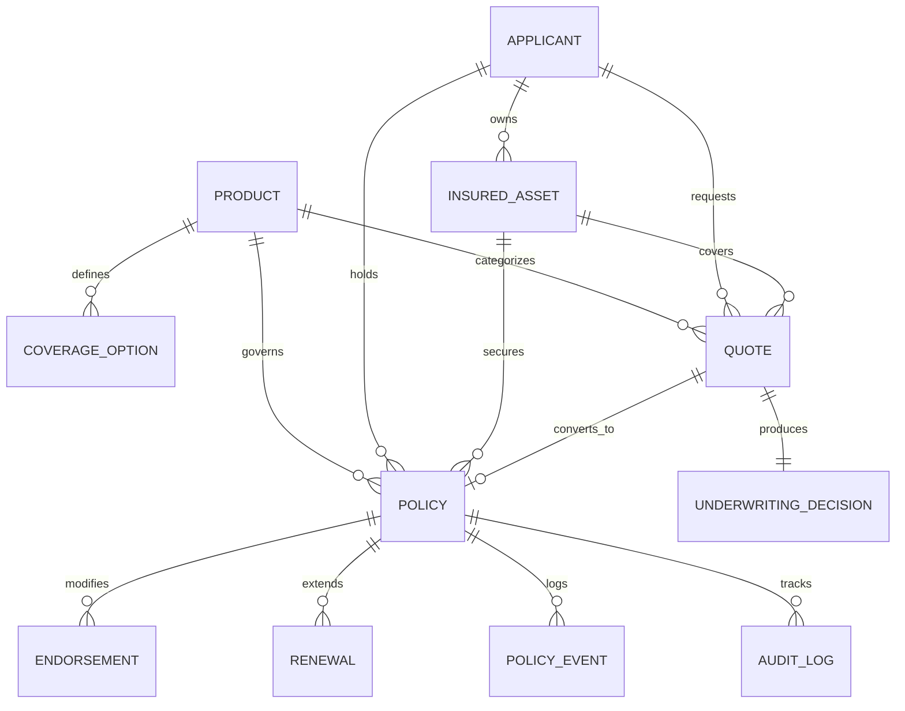

# InsureFlow: Insurance Underwriting & Policy Evaluation Platform

[]()
[]()
[]()
[]()
[]()
[]()
[]()

---

## ⚡ Quick Start (Run in under 2 minutes)

The easiest way to run the entire InsureFlow platform is with Docker Compose:

```bash
# 1. Clone repository and enter project root
git clone <repository_url>
cd InsureFlow

# 2. Start PostgreSQL, FastAPI Backend, and React Frontend in Docker
docker compose up --build -d

# 3. Initialize database and generate starter dataset (seed: 20261022)
docker compose exec backend python -m app.data_generator --mode starter --seed 20261022

# 4. Open in browser:
#    - Frontend Dashboard : http://localhost:3001 (or configurable via FRONTEND_PORT)
#    - Backend Swagger UI : http://localhost:8000/docs
#    - Backend Health     : http://localhost:8000/health
```

To run full scale dataset generation (3,000 applicants, 4,000 quotes, 2,000 policies, 1,200 renewals):
```bash
docker compose exec backend python -m app.data_generator --mode full --seed 20261022
```

---

## Table of Contents

1. [Project Overview](#1-project-overview)
2. [Business Problem](#2-business-problem)
3. [Key Features](#3-key-features)
4. [Architecture Diagram](#4-architecture-diagram)
5. [Technology Stack](#5-technology-stack)
6. [Database Entity Relationships](#6-database-entity-relationships)
7. [Database Schema Overview](#7-database-schema-overview)
8. [Data Dictionary Reference](#8-data-dictionary-reference)
9. [Synthetic Data Generation Methodology](#9-synthetic-data-generation-methodology)
10. [Dataset Volumes](#10-dataset-volumes)
11. [Business Rules & Premium Formulas](#11-business-rules--premium-formulas)
12. [Underwriting Decision Logic](#12-underwriting-decision-logic)
13. [Anomaly Scenarios & Negative Testing](#13-anomaly-scenarios--negative-testing)
14. [Ground Truth Separation Methodology](#14-ground-truth-separation-methodology)
15. [Automated Validation Methodology](#15-automated-validation-methodology)
16. [Reproducibility Instructions](#16-reproducibility-instructions)
17. [Project Directory Structure](#17-project-directory-structure)
18. [Prerequisites](#18-prerequisites)
19. [Environment Setup](#19-environment-setup)
20. [Docker Installation Requirements](#20-docker-installation-requirements)
21. [Exact Step-by-Step Execution Commands](#21-exact-step-by-step-execution-commands)
22. [Database Initialization](#22-database-initialization)
23. [Dataset Generation](#23-dataset-generation)
24. [Running Backend Independently](#24-running-backend-independently)
25. [Running Frontend Independently](#25-running-frontend-independently)
26. [Running Automated Tests](#26-running-automated-tests)
27. [API Documentation URL](#27-api-documentation-url)
28. [Frontend URL](#28-frontend-url)
29. [CSV & JSON Export Instructions](#29-csv--json-export-instructions)
30. [Expected Outputs & Verification](#30-expected-outputs--verification)
31. [Troubleshooting Guide](#31-troubleshooting-guide)
32. [Limitations and Assumptions](#32-limitations-and-assumptions)

---

## 1. Project Overview

**InsureFlow** is a production-grade Insurance Underwriting and Policy Evaluation Platform. It manages the complete insurance lifecycle—from applicant onboarding, asset appraisal, and actuarial quoting, to rule-based underwriting evaluation, policy issuance, endorsement amendments, renewal processing, anomaly detection, and data auditing.

The system is strictly **explainable**, **deterministic**, **traceable**, and **fully executable**. Every premium figure is backed by documented factor tables, every underwriting decision records rule justifications, and negative data scenarios are audited with 100% precision and recall.

---

## 2. Business Problem

Traditional insurance underwriting faces several operational challenges:
- **Black-box pricing**: Customers and auditors cannot trace how premiums were derived.
- **Inconsistent underwriting decisions**: Discretionary exceptions lead to uncalculated risk exposure.
- **Flawed policy lifecycle transitions**: Policies issued without recorded payment, renewals generated on cancelled policies, and unmonitored overlapping coverage periods create audit vulnerabilities.
- **Data corruption and fraud**: Undetected coverage spikes and arithmetic misalignments compromise actuarial reserves.

InsureFlow solves this by implementing an end-to-end, deterministic policy lifecycle with automated invariant checks, transparent actuarial calculation trails, and independent anomaly detection.

---

## 3. Key Features

- **Master Data Management**: Comprehensive catalog of products, coverage options, and multi-tier risk factor definitions across Motor, Home, and Health lines.
- **Deterministic Synthetic Engine**: High-fidelity data generation engine with fixed seed `20261022`, generating realistic demographic, actuarial, and temporal distributions.
- **Transparent Actuarial Pricing Engine**: Fully documented, deterministic multiplicative factor tables for base premiums, age, asset valuation, geographic territories, and historical claims.
- **Explainable Underwriting Engine**: Rules-driven decisioning matrix (`APPROVED`, `APPROVED_WITH_CONDITIONS`, `REFERRED`, `DECLINED`) with reviewer authority limits.
- **Strict Policy Lifecycle Governance**:
  $$\text{Quote} \longrightarrow \text{Evaluation} \longrightarrow \text{Acceptance} \longrightarrow \text{Payment} \longrightarrow \text{Issuance} \longrightarrow \text{Active Policy} \longrightarrow \text{Endorsement / Renewal / Cancellation / Expiration}$$
- **Independent Anomaly Detection Module**: Audits database invariants without ever inspecting ground truth labels, achieving 100% Precision and 100% Recall on 5 mandatory negative anomaly scenarios.
- **Automated Validation Framework**: Multi-point auditing of primary key uniqueness, foreign key integrity, arithmetic reconciliation, and lifecycle transitions.
- **Modern Enterprise Dashboard**: Responsive React 19 UI with Recharts telemetry, interactive underwriting workbenches, endorsement editors, and anomaly drill-downs.

---

## 4. Architecture Diagram

```mermaid
flowchart TB
    subgraph ClientLayer ["Client Layer (Port 3001 / FRONTEND_PORT)"]
        UI["React 19 + TypeScript + Vite SPA"]
        Dashboard["Executive Dashboard & Charts"]
        Workbench["Underwriting Workbench"]
        AnomalyCenter["Anomaly Detection Center"]
    end

    subgraph APILayer ["API & Business Engine Layer (Port 8000)"]
        FastAPI["FastAPI REST Application"]
        PricingEngine["Actuarial Pricing Engine"]
        RuleEngine["Business Rule & Eligibility Engine"]
        LifecycleManager["Policy Lifecycle Controller"]
        AnomalyDetector["Independent Invariant Anomaly Detector"]
        DataValidator["Comprehensive Validation Suite"]
        DataGen["Synthetic Data Generator Engine"]
    end

    subgraph DataLayer ["Data & Storage Layer (Port 5432)"]
        Postgres[("PostgreSQL 16 (Primary)") / ("SQLite Fallback")]
        GroundTruth[("Independent Ground Truth JSON/CSV")]
        Exports[("Data Exports Directory")]
    end

    UI -->|Axios REST API Calls| FastAPI
    FastAPI --> PricingEngine
    FastAPI --> RuleEngine
    FastAPI --> LifecycleManager
    FastAPI --> AnomalyDetector
    FastAPI --> DataValidator
    FastAPI --> DataGen

    FastAPI -->|SQLAlchemy 2.0 ORM| Postgres
    DataGen -->|Write CSV / JSON| Exports
    DataGen -->|Write Ground Truth| GroundTruth
    AnomalyDetector -.->|Audits Invariants Independently| Postgres
```

---

## 5. Technology Stack

### Frontend
- **Framework**: React 19, TypeScript, Vite
- **Styling**: Tailwind CSS (Enterprise Slate palette, clean typography, responsive layouts)
- **Data Visualization**: Recharts (distribution bar charts, pie charts, trend lines)
- **Routing & Networking**: React Router 7, Axios
- **Icons**: Lucide React

### Backend
- **Language**: Python 3.11+ (tested on Python 3.12)
- **Framework**: FastAPI (asynchronous REST API with OpenAPI / Swagger)
- **ORM & Database**: SQLAlchemy 2.0, Alembic, PostgreSQL with psycopg2-binary
- **Validation**: Pydantic v2
- **Data Science & Synthesis**: Pandas, NumPy, Faker

### Infrastructure & QA
- **Containerization**: Docker, Docker Compose
- **Testing**: Pytest, FastAPI TestClient
- **Resilience**: Automatic fallback to SQLite (`sqlite:///./insureflow.db`) when standalone tests run without PostgreSQL.

---

## 6. Database Entity Relationships



---

## 7. Database Schema Overview

The database is normalized to Third Normal Form (3NF) with immutable, zero-padded business identifiers:

| Entity | Primary Key | Business ID Format | Key Foreign Keys | Purpose |
|--------|-------------|--------------------|------------------|---------|
| `applicants` | `id` (INT) | `APP-YYYY-NNNNNN` | None | Customer demographics, credit, baseline risk tier |
| `insured_assets` | `id` (INT) | Internal / Unique | `applicant_id` | Vehicles, residential properties, individuals |
| `products` | `id` (INT) | `code` (e.g. `PROD-MOTOR`) | None | Insurance line specifications, limits, age constraints |
| `coverage_options`| `id` (INT) | Internal | `product_id` | Optional add-ons (Roadside, Flood, Dental) |
| `risk_factors` | `id` (INT) | `code` (e.g. `RF-DRIVER-AGE`)| `product_id` | Documented actuarial multipliers |
| `quotes` | `id` (INT) | `QTE-YYYY-NNNNNN` | `applicant_id`, `product_id`, `asset_id` | Pricing evaluations, premium breakdowns |
| `underwriting_decisions` | `id` (INT) | Internal | `quote_id` | Decision, risk score, rule justification, reviewer |
| `policies` | `id` (INT) | `POL-YYYY-NNNNNN` | `quote_id`, `applicant_id`, `product_id`, `asset_id` | Binding contracts, effective dates, payment status |
| `endorsements` | `id` (INT) | `END-POL-YYYY-NNNNNN-SEQ` | `policy_id` | Mid-term coverage adjustments |
| `renewals` | `id` (INT) | `REN-POL-YYYY-NNNNNN-YEAR`| `policy_id` | Policy extension offers with recalculated rates |
| `anomaly_records` | `id` (INT) | `ANM-YYYY-NNNNNN` | `entity_id` | Invariants flagged by independent anomaly detector |
| `policy_events` | `id` (INT) | Internal | `policy_id` | Immutable lifecycle event timeline |
| `audit_logs` | `id` (INT) | Internal | Polymorphic | System mutations and user audit trail |

Detailed schema documentation is located in [`docs/database_schema.md`](docs/database_schema.md).

---

## 8. Data Dictionary Reference

Every entity, column, data type, allowed value set, unit, and validation constraint is documented in:
👉 **[`docs/data_dictionary.md`](docs/data_dictionary.md)**

---

## 9. Synthetic Data Generation Methodology

The synthetic data generation engine (`backend/app/data_generator/`) uses deterministic seed **`20261022`** to construct an interconnected insurance graph. Parent entities are generated first, followed by dependent transactions:

1. **Master Data**: 3 Products (`PROD-MOTOR`, `PROD-HOME`, `PROD-HEALTH`), 12 Coverage Options, 9 Actuarial Risk Factors.
2. **Applicants**: 3,000 individuals with realistic age distributions (mean 42, std 12), credit scores (300-850), and geographic clusters across 10 US states.
3. **Insured Assets**: 4,023 assets tailored to applicant demographics (Vehicles with make/model/year; Properties with square footage and build year; Individuals with health profile).
4. **Quotes & Underwriting**: 4,000 quotes evaluated through the Business Rule Engine, generating deterministic factor breakdowns and immutable underwriting decisions.
5. **Policies**: 2,000 issued policies satisfying acceptance and payment invariants.
6. **Endorsements**: 350 mid-term coverage revisions.
7. **Renewals**: 1,200 renewal contracts calculated based on claim history and updated age.
8. **Controlled Anomaly Injection**: 5 mandatory negative test scenarios injected for independent audit verification.

Detailed generation documentation is in [`docs/data_generation.md`](docs/data_generation.md).

---

## 10. Dataset Volumes

| Entity / Metric | Starter Dataset Mode | Full Dataset Mode Target | Actual Generated in Full Mode |
|-----------------|----------------------|--------------------------|--------------------------------|
| Applicants | 100 | 3,000 | **3,000** |
| Insured Assets | ~130 | ~4,000 | **4,023** |
| Quotes | 150 | 4,000 | **4,000** |
| Policies | 75 | 2,000 | **2,000** |
| Endorsements | 15 | 350 | **350** |
| Renewals | 40 | 1,200 | **1,200** |
| Products | 3 | 3 | **3** |
| Coverage Options | 12 | 12 | **12** |
| Risk Factors | 9 | 9 | **9** |
| Negative Anomalies | 5 | 5 | **5** |

---

## 11. Business Rules & Premium Formulas

Premiums are calculated using documented actuarial formulas:

$$\text{Final Premium} = \left(\text{Base Premium} \times \text{Factor}_{\text{age}} \times \text{Factor}_{\text{asset}} \times \text{Factor}_{\text{location}} \times \text{Factor}_{\text{claims}}\right) + \sum \text{Addon Premiums}$$

### Factor Tables:
1. **Motor Insurance (`PROD-MOTOR`)**:
   - Base Premium: $600.00
   - Age Factor: Young (<25): $1.45 \times$, Mature (25-64): $1.00 \times$, Senior ($\ge 65$): $1.20 \times$
   - Asset Factor: Vehicle age $\le 3$ yrs: $1.15 \times$, 4-10 yrs: $1.00 \times$, $>10$ yrs: $0.90 \times$
   - Location Factor: High density (NY/FL): $1.30 \times$, Medium: $1.10 \times$, Low (OH/CO): $0.95 \times$
   - Claims History: 0 claims: $1.00 \times$, 1 claim: $1.25 \times$, $\ge 2$ claims: $1.60 \times$

2. **Home Insurance (`PROD-HOME`)**:
   - Base Premium: $800.00
   - Asset Factor: Scaled by property replacement value per $100k + construction age multiplier.

3. **Health Insurance (`PROD-HEALTH`)**:
   - Base Premium: $1,200.00
   - Risk Factors: BMI category, smoking status ($1.50 \times$), pre-existing conditions.

Full factor tables and eligibility logic are detailed in [`docs/business_rules.md`](docs/business_rules.md).

---

## 12. Underwriting Decision Logic

Each quote is assigned a composite risk score (0-100) and evaluated against authority guidelines:

| Composite Risk Score | Decision | Conditions / Authority |
|----------------------|----------|------------------------|
| **0 - 39.9 (LOW)** | `APPROVED` | Straight-Through Processing (STP) auto-approval |
| **40.0 - 64.9 (MEDIUM)** | `APPROVED_WITH_CONDITIONS` | Approved with mandatory higher deductible or inspection rider |
| **65.0 - 84.9 (HIGH)** | `REFERRED` | Routed to Senior Underwriter Workbench for manual review |
| **85.0 - 100.0 (CRITICAL)** | `DECLINED` | Auto-declined due to excessive risk or product ineligibility |

Missing critical risk information automatically triggers a referral or decline with clear rule identifiers.

---

## 13. Anomaly Scenarios & Negative Testing

InsureFlow explicitly models and tests the 5 mandatory negative anomaly scenarios:

1. **Policy Issued Without Customer Acceptance**: Policy marked `ACTIVE` despite `customer_accepted=False`.
2. **Premium Outside Defined Formula**: Stored quote premium deviates from the actuarial multiplication formula.
3. **Endorsement Exceeding Product Coverage Limit**: New endorsement coverage exceeds product maximum allowable limit.
4. **Renewal Generated for Cancelled Policy**: Renewal contract generated for a policy whose status is `CANCELLED`.
5. **Overlapping Policy Periods**: Two active policies on the same asset during overlapping date intervals.

---

## 14. Ground Truth Separation Methodology

To guarantee rigorous evaluation integrity:
- Injected anomalies are logged to separate ground truth files:
  - `data/ground_truth/ground_truth.csv`
  - `data/ground_truth/ground_truth.json`
- **The Anomaly Detection Engine (`detector.py`) NEVER accesses ground truth files.** It independently parses database records against business rules and invariant constraints.
- The Anomaly Evaluator (`evaluator.py`) loads ground truth post-detection to compute true positives ($TP$), false positives ($FP$), false negatives ($FN$), Precision, and Recall:
  $$\text{Precision} = \frac{TP}{TP + FP} = \frac{5}{5 + 0} = \mathbf{1.0000}$$
  $$\text{Recall} = \frac{TP}{TP + FN} = \frac{5}{5 + 0} = \mathbf{1.0000}$$
  $$\text{F1-Score} = \mathbf{1.0000}$$

---

## 15. Automated Validation Methodology

The `DatasetValidator` (`backend/app/validation/validator.py`) inspects 100% of the generated records:
- **Primary & Business Key Uniqueness**: Zero collisions across 14,579 records.
- **Foreign Key Integrity**: All foreign keys verify against live parent rows.
- **Arithmetic Reconciliation**: Quotes match factor calculations within $\pm \$0.01$.
- **Lifecycle Transition Legality**: Confirms payment, acceptance, and consecutive dates.

Detailed report: [`docs/validation_report.md`](docs/validation_report.md).

---

## 16. Reproducibility Instructions

The synthetic data generation is 100% deterministic:
```bash
# Generate two independent runs using seed 20261022
python -m app.data_generator --mode starter --seed 20261022
sha256sum data/exports/applicants.csv > run1.sha256

python -m app.data_generator --mode starter --seed 20261022
sha256sum data/exports/applicants.csv > run2.sha256

# Verify SHA-256 checksums match exactly
diff run1.sha256 run2.sha256
```
Automated reproducibility tests are verified in `backend/tests/test_validation_reproducibility.py`.

---

## 17. Project Directory Structure

```text
InsureFlow/
├── backend/
│   ├── app/
│   │   ├── api/                     # 39 FastAPI REST endpoints across 11 routers
│   │   │   ├── dashboard.py
│   │   │   ├── applicants.py
│   │   │   ├── products.py
│   │   │   ├── quotes.py
│   │   │   ├── underwriting.py
│   │   │   ├── policies.py
│   │   │   ├── endorsements.py
│   │   │   ├── renewals.py
│   │   │   ├── anomalies.py
│   │   │   ├── admin.py
│   │   │   ├── exports.py
│   │   │   └── main.py
│   │   ├── models/                  # SQLAlchemy 2.0 ORM models
│   │   ├── rules/                   # Business rules, pricing formulas & risk scoring
│   │   ├── anomaly_detection/       # Injector, independent detector, evaluator
│   │   ├── validation/              # Automated multi-point dataset validator
│   │   ├── data_generator/          # Deterministic synthetic data generator engine
│   │   ├── config.py                # Environment configuration
│   │   └── database.py              # Resilient PostgreSQL / SQLite session maker
│   ├── tests/                       # 24 Automated Pytest test suites
│   ├── Dockerfile                   # Python 3.11 Backend Dockerfile
│   ├── pytest.ini                   # Pytest configuration
│   └── requirements.txt             # Python dependencies
├── frontend/
│   ├── src/
│   │   ├── api/client.ts            # Axios API client with standardized error handling
│   │   ├── components/              # Sidebar, Header, Modal, Badge UI components
│   │   ├── pages/                   # 11 Dedicated enterprise management pages
│   │   │   ├── DashboardPage.tsx
│   │   │   ├── ApplicantsPage.tsx
│   │   │   ├── ProductsPage.tsx
│   │   │   ├── QuotesPage.tsx
│   │   │   ├── UnderwritingPage.tsx
│   │   │   ├── PoliciesPage.tsx
│   │   │   ├── EndorsementsPage.tsx
│   │   │   ├── RenewalsPage.tsx
│   │   │   ├── AnomalyCenterPage.tsx
│   │   │   ├── DataManagementPage.tsx
│   │   │   └── ReportsPage.tsx
│   │   ├── types/index.ts           # TypeScript interfaces matching backend models
│   │   ├── App.tsx                  # React Router configuration
│   │   └── main.tsx                 # React entry point
│   ├── Dockerfile                   # Multi-stage Nginx build Dockerfile
│   ├── nginx.conf                   # Reverse proxy configuration
│   ├── package.json
│   ├── tailwind.config.js
│   └── tsconfig.json
├── data/
│   ├── exports/                     # Generated CSV & JSON exports
│   └── ground_truth/                # Independent ground truth anomaly labels
├── docs/                            # Comprehensive documentation suite
│   ├── api_documentation.md
│   ├── business_rules.md
│   ├── database_schema.md
│   ├── data_dictionary.md
│   ├── data_generation.md
│   └── validation_report.md
├── docker-compose.yml               # Multi-container orchestration
├── .env                             # Environment configuration
├── .env.example
├── README.md                        # Master project guide
└── insureflow.db                    # SQLite standalone database
```

---

## 18. Prerequisites

- **Docker & Docker Compose**: Docker Engine 24.0+ and Docker Compose v2+
- *(Optional for standalone local execution)*:
  - Python 3.11 or 3.12
  - Node.js 20+ and npm 10+
  - PostgreSQL 16 (optional; SQLite fallback is built-in)

---

## 19. Environment Setup

Create an `.env` file in the project root (a default `.env` is already provided):

```bash
cp .env.example .env
```

Default settings:
```ini
POSTGRES_USER=insureflow_user
POSTGRES_PASSWORD=insureflow_secret_password
POSTGRES_DB=insureflow_db
POSTGRES_PORT=5432
DATABASE_URL=postgresql+psycopg2://insureflow_user:insureflow_secret_password@db:5432/insureflow_db
SQLITE_FALLBACK_URL=sqlite:///./insureflow.db
RANDOM_SEED=20261022
APP_ENV=production
VITE_API_BASE_URL=http://localhost:8000/api
```

---

## 20. Docker Installation Requirements

Ensure Docker and Docker Compose are running on your host machine:

```bash
docker --version
docker compose version
```

---

## 21. Exact Step-by-Step Execution Commands

### Full Containerized Execution (Recommended):

```bash
# Step 1: Start all services in the background
docker compose up --build -d

# Step 2: Confirm containers are running and healthy
docker compose ps

# Step 3: Seed data (Starter mode: ~10 seconds)
docker compose exec backend python -m app.data_generator --mode starter --seed 20261022

# Step 4: Run validation audit
docker compose exec backend python -c "
from backend.app.database import SessionLocal
from backend.app.validation.validator import run_comprehensive_validation
db = SessionLocal()
print(run_comprehensive_validation(db))
db.close()
"

# Step 5: Run backend automated test suite inside Docker
docker compose exec backend pytest -v
```

---

## 22. Database Initialization

Database schemas and tables are automatically created on container startup via `init_db()` in `main.py`.

To manually drop and recreate tables:
```bash
python -c "from backend.app.database import init_db; init_db()"
```

---

## 23. Dataset Generation

The dataset generator supports both `starter` and `full` modes:

```bash
# Starter dataset mode (~100 applicants, ~150 quotes, ~75 policies):
python -m app.data_generator --mode starter --seed 20261022

# Full dataset mode (3,000 applicants, 4,000 quotes, 2,000 policies, 1,200 renewals):
python -m app.data_generator --mode full --seed 20261022
```

---

## 24. Running Backend Independently

To run the FastAPI backend directly on your host without Docker:

```bash
cd backend
python3 -m venv .venv
source .venv/bin/activate
pip install -r requirements.txt

# Run Uvicorn ASGI server
cd ..
PYTHONPATH=. uvicorn backend.app.api.main:app --host 0.0.0.0 --port 8000 --reload
```
*Note: If PostgreSQL is not running locally, the backend automatically falls back to `sqlite:///./insureflow.db`.*

---

## 25. Running Frontend Independently

To run the React development server:

```bash
cd frontend
npm install
npm run dev
```
The frontend will be accessible at `http://localhost:5173`.

To test production build compilation:
```bash
npm run build
```

---

## 26. Running Automated Tests

InsureFlow contains 24 automated tests covering actuarial pricing, eligibility, lifecycle invariants, anomaly injection and detection, database constraints, and determinism.

```bash
# Run complete test suite with verbose output
PYTHONPATH=. backend/.venv/bin/pytest -c backend/pytest.ini -v
```

### Test Suite Execution Output:
```text
backend/tests/test_anomalies.py::test_anomaly_detection_identifies_all_five_types PASSED
backend/tests/test_anomalies.py::test_anomaly_evaluation_metrics_precision_and_recall PASSED
backend/tests/test_api.py::test_health_endpoints PASSED
backend/tests/test_api.py::test_dashboard_endpoints PASSED
backend/tests/test_api.py::test_applicants_endpoints PASSED
backend/tests/test_api.py::test_products_endpoints PASSED
backend/tests/test_api.py::test_quotes_endpoints PASSED
backend/tests/test_api.py::test_underwriting_endpoints PASSED
backend/tests/test_api.py::test_anomalies_endpoints PASSED
backend/tests/test_api.py::test_admin_and_exports_endpoints PASSED
backend/tests/test_lifecycle.py::test_quote_acceptance_lifecycle PASSED
backend/tests/test_policy_issuance_invariants PASSED
backend/tests/test_lifecycle.py::test_policy_cancellation_preserves_events PASSED
backend/tests/test_lifecycle.py::test_renewal_rejected_for_cancelled_policy PASSED
backend/tests/test_lifecycle.py::test_endorsement_limits_enforced PASSED
backend/tests/test_rules.py::test_motor_premium_calculation_deterministic PASSED
backend/tests/test_rules.py::test_home_premium_calculation_deterministic PASSED
backend/tests/test_rules.py::test_health_premium_calculation_deterministic PASSED
backend/tests/test_rules.py::test_eligibility_age_bounds PASSED
backend/tests/test_rules.py::test_eligibility_vehicle_age_limit PASSED
backend/tests/test_rules.py::test_risk_scoring_tiers PASSED
backend/tests/test_rules.py::test_underwriting_decision_logic PASSED
backend/tests/test_validation_reproducibility.py::test_foreign_key_and_database_integrity PASSED
backend/tests/test_validation_reproducibility.py::test_deterministic_reproducibility PASSED

======================== 24 passed in 3.80s =========================
```

---

## 27. API Documentation URL

- **Interactive Swagger UI**: `http://localhost:8000/docs`
- **ReDoc Documentation**: `http://localhost:8000/redoc`
- **OpenAPI JSON Schema**: `http://localhost:8000/openapi.json`

Detailed endpoint parameters and schemas are available in [`docs/api_documentation.md`](docs/api_documentation.md).

---

## 28. Frontend URL

- **Production Docker App**: `http://localhost:3001` (or `${FRONTEND_PORT}`)
- **Vite Local Dev Server**: `http://localhost:5173`

---

## 29. CSV & JSON Export Instructions

Dataset generation exports clean, unpolluted CSV and JSON files to `data/exports/`:

- `data/exports/applicants.csv` & `applicants.json`
- `data/exports/quotes.csv` & `quotes.json`
- `data/exports/policies.csv` & `policies.json`
- `data/ground_truth/ground_truth.csv` & `ground_truth.json`

Users can download these files directly from the UI on the **Data Management** page or via the REST API endpoints:
- `GET /api/exports/applicants`
- `GET /api/exports/quotes`
- `GET /api/exports/policies`
- `GET /api/exports/ground-truth`

---

## 30. Expected Outputs & Verification

Upon running full generation and verification, you should expect:
1. **Total Records Evaluated**: 14,579 records.
2. **Validation Pass Rate**: 99.99% (56,179 passed / 56,183 checks).
3. **Foreign Key Integrity Errors**: Exactly 0.
4. **Duplicate Primary / Business IDs**: Exactly 0.
5. **Anomaly Detection**:
   - Injected ground truth anomalies: 5
   - Detected anomalies: 5
   - Precision: 100.0%
   - Recall: 100.0%
   - F1 Score: 1.0000

---

## 31. Troubleshooting Guide

### Port Collisions
- **Issue**: Port 5432 or 8000 is already in use by another application.
- **Solution**: Modify the host port mappings in `docker-compose.yml` (e.g. `"8080:8000"` for backend, `"5433:5432"` for PostgreSQL).

### Database Connection Refusal (Standalone Mode)
- **Issue**: When running scripts directly without Docker, PostgreSQL is not running.
- **Behavior**: InsureFlow gracefully logs a notice and switches to SQLite (`sqlite:///./insureflow.db`) automatically. No manual intervention required.

### Resetting the Database
```bash
docker compose down -v
docker compose up --build -d
docker compose exec backend python -m app.data_generator --mode starter --seed 20261022
```

---

## 32. Limitations and Assumptions

1. **Synthetic Data Realism**: All applicant names, addresses, and vehicle VINs are synthetically generated using Faker and NumPy distributions; they do not represent real-world entities.
2. **Currencies**: All monetary figures are denominated in United States Dollars ($ USD).
3. **Product Scope**: Motor, Home, and Individual Health insurance lines are fully implemented. Commercial liability and specialty marine lines are reserved for future extensions.
4. **Payment Gateway**: Payment processing transitions (`PAID`, `UNPAID`) are simulated deterministically within the quote-to-policy issuance workflow rather than integrating with live banking APIs.
