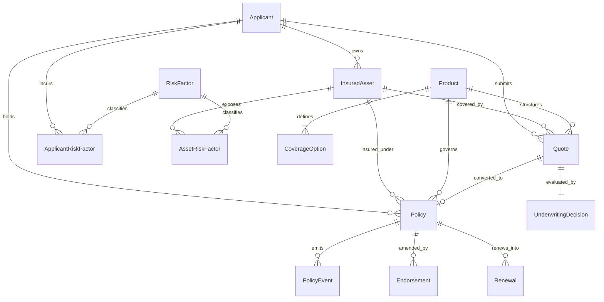

# InsureFlow Database Schema & Architecture

This document outlines the relational database architecture, entity relationships, normal forms, indexing strategy, and integrity constraints for **InsureFlow**.

---

## 1. Relational Entity Relationship Diagram

---

## 2. Normalization Strategy (Third Normal Form - 3NF)

The database schema is strictly normalized to **Third Normal Form (3NF)**:
1. **First Normal Form (1NF)**:
   - All columns contain atomic, indivisible values.
   - Primary keys uniquely identify every row.
   - Zero-padded immutable business identifiers (`APP-2026-000001`, `POL-2026-000001`, `QTE-2026-000001`) are segregated from internal surrogate sequence IDs.

2. **Second Normal Form (2NF)**:
   - All non-key attributes depend fully on the complete primary key.
   - Many-to-many associations (such as risk factors linked to applicants or assets) are resolved into normalized bridge tables (`applicant_risk_factors`, `asset_risk_factors`).

3. **Third Normal Form (3NF)**:
   - No transitive dependencies exist.
   - Product limits and line-of-business underwriting rules reside solely in the master `products` and `coverage_options` tables, eliminating duplication.

---

## 3. Immutable Business Identifiers & Sequences

In financial enterprise insurance systems, surrogate database integers must never be exposed as customer transaction references. InsureFlow enforces deterministic, zero-padded immutable business ID conventions:

| Entity | Identifier Format | Description |
| :--- | :--- | :--- |
| **Applicant** | `APP-YYYY-NNNNNN` | e.g. `APP-2026-000001` |
| **Insured Asset** | `AST-YYYY-NNNNNN` | e.g. `AST-2026-000001` |
| **Product** | `PRD-{LOB}-NNN` | e.g. `PRD-MOTOR-001`, `PRD-HOME-001`, `PRD-HEALTH-001` |
| **Quote** | `QTE-YYYY-NNNNNN` | e.g. `QTE-2026-000001` |
| **Underwriting Decision** | `DEC-YYYY-NNNNNN` | e.g. `DEC-2026-000001` |
| **Policy** | `POL-YYYY-NNNNNN` | e.g. `POL-2026-000001` |
| **Endorsement** | `END-{POL_ID}-{SEQ}` | e.g. `END-POL-2026-000001-001` |
| **Renewal** | `REN-{POL_ID}-{YEAR}` | e.g. `REN-POL-2026-000001-2027` |
| **Anomaly Record** | `ANM-YYYY-NNNNNN` | e.g. `ANM-2026-000001` |

---

## 4. Referential Integrity & Cascade Rules

- **Foreign Keys**:
  - `insured_assets.applicant_id` -> `applicants.id` (`ON DELETE CASCADE`)
  - `quotes.applicant_id` -> `applicants.id` (`ON DELETE RESTRICT`)
  - `quotes.asset_id` -> `insured_assets.id` (`ON DELETE RESTRICT`)
  - `quotes.product_id` -> `products.id` (`ON DELETE RESTRICT`)
  - `underwriting_decisions.quote_id` -> `quotes.id` (`ON DELETE CASCADE`, `UNIQUE`)
  - `policies.quote_id` -> `quotes.id` (`ON DELETE RESTRICT`, `UNIQUE`)
  - `policies.applicant_id` -> `applicants.id` (`ON DELETE RESTRICT`)
  - `policies.asset_id` -> `insured_assets.id` (`ON DELETE RESTRICT`)
  - `policies.product_id` -> `products.id` (`ON DELETE RESTRICT`)
  - `endorsements.policy_id` -> `policies.id` (`ON DELETE CASCADE`)
  - `renewals.previous_policy_id` -> `policies.id` (`ON DELETE RESTRICT`)
  - `renewals.new_policy_id` -> `policies.id` (`ON DELETE SET NULL`)
  - `policy_events.policy_id` -> `policies.id` (`ON DELETE CASCADE`)

---

## 5. Indexing Strategy

High-frequency query patterns in insurance operations are accelerated using B-Tree database indexes:
- `applicants(business_id)`: Unique lookup
- `applicants(email)`: Unique constraint & login/lookup
- `insured_assets(business_id)`: Unique lookup
- `quotes(business_id)`: Unique lookup
- `quotes(status, risk_tier)`: Filtered dashboard queries
- `policies(business_id)`: Unique contract retrieval
- `policies(status, product_id)`: Lifecycle queries
- `endorsements(business_id)`: Unique endorsement transaction retrieval
- `renewals(business_id)`: Unique renewal cycle retrieval
- `anomaly_records(business_id, issue_type)`: Fast detection reporting
